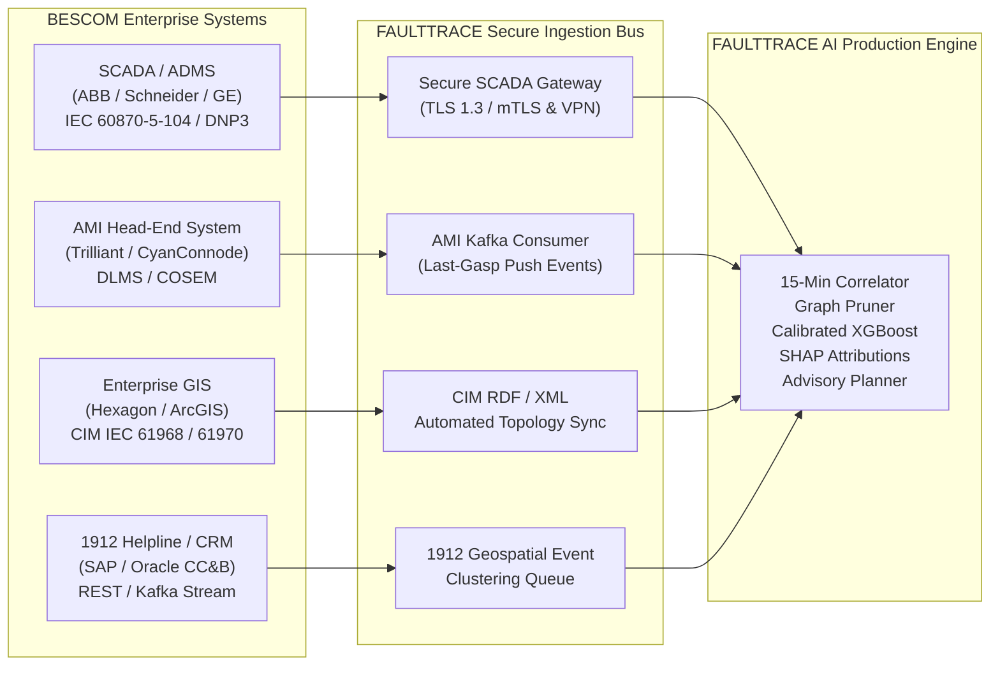

# FAULTTRACE AI: Operational Limitations and Synthetic Assumptions

**BESCOM Power Hack 2026 — Theme 10**  
**Document Classification**: Transparent System Boundaries & Production Roadmap  
**Target Audience**: Technical Evaluation Committee & BESCOM Grid Automation Engineers

---

## 1. Executive Statement of Authenticity

FAULTTRACE AI is an advanced prototype and operational decision-support system built for demonstration under BESCOM Power Hack 2026. In accordance with the hackathon charter and good engineering practice, this document transparently states what is simulated, what is mathematically approximated, what safety invariants are enforced, and what technical steps are required for a real-world field deployment across BESCOM subdivisions.

---

## 2. 100% Synthetic Telemetry & Network Environment

- **Synthetic Network Topologies**: The 2 substations (`SS-NORTH-01`, `SS-EAST-02`), 8 feeders (`F1` through `F8`), 140 sections, 48 distribution transformers, and tie switches are synthetic models designed to mimic the topology of urban distribution feeders in Bengaluru (e.g. Peenya, Hebbal, Yelahanka). Latitude and longitude coordinates are geocoded to the Bengaluru metropolitan region for spatial realism but do not represent physical confidential BESCOM asset coordinates.
- **Simulated SCADA & SOE Telemetry**: All breaker trip signals, protective relay timings, Sequence of Events (SOE) logs, and remote terminal unit (RTU) alarms are generated via stochastic simulation. No direct IP tunnel, VPN, or tele-control circuit to physical BESCOM substations exists.
- **Simulated AMI Smart Meter Data**: Smart meter voltage drop pings (230V down to 0V) and loss-of-supply notifications are simulated at the transformer low-voltage (LV) busbar. While realistic Gaussian noise ($\sigma = 2\text{--}5\%$) is injected, physical communication latency spikes (RF-mesh packet drops or cellular GPRS fade) are modeled synthetically.
- **Customer Helpline Complaints**: Outage calls to the 1912 helpline are generated using an inhomogeneous Poisson arrival process conditioned on storm wind gust speeds, time of day, and downstream transformer de-energization. Spatial complaint clustering includes synthetic false-report noise (~5% of complaints originate from non-outage areas).

---

## 3. Simulated Electrical Model vs. Full Dynamic AC Power Flow

- **Impedance-Based Path Model**: The system computes steady-state voltage drops and power transfers using synthetic $R + jX$ conductor impedances stored in the database.
- **No Dynamic Electro-Magnetic Transient (EMT) Simulation**: The graph engine and simulator do not execute sub-cycle dynamic transient electromagnetic models (e.g., PSCAD or EMTP). Phenomena such as high-impedance arcing faults through dry tree branches, sub-synchronous resonance, or lightning surge impulse reflections are approximated through statistical feature surrogates rather than numerical differential equations.
- **No Full AC Newton-Raphson Power Flow**: Restoration feeder capacity headroom checks use a steady-state thermal MVA heuristic (~55% nominal base load) rather than solving a non-linear AC power flow optimization (e.g., OpenDSS or Pandapower). In real operations, an AC load flow solver is required to verify that back-feeding does not violate busbar voltage limits ($\pm 6\%$) or cause phase angle instability during open-transition switching.

---

## 4. "Topology-Consistent Candidates" vs. "Mathematical Proof"

- **Graph Pruning Boundary**: The NetworkX graph engine prunes candidates between the last observed-energized node and the first observed-de-energized node. This identifies all **"topology-consistent candidates"**.
- **No Infallible Localization**: If an intermediate section has no smart meter or sensor at either terminal, the system cannot mathematically prove which specific span between two poles suffered physical conductor breakage without field physical inspection. Control room personnel must treat model outputs as high-probability candidate rankings, not infallible physical telemetry.

---

## 5. Model Scores vs. Calibrated Probabilities

- **Uncalibrated Model Scores**: Raw values emitted by gradient-boosted decision trees (XGBoost) represent relative ranking margins, not true physical probabilities.
- **Isotonic Calibration**: Post-hoc calibration using Isotonic Regression maps these raw scores into calibrated probabilities evaluated on held-out validation scenarios ($ECE = 0.0054$). 
- **Integrity Guarantee**: Metrics displayed in the user interface (Top-1: 62.7%, Top-3: 89.3%, ECE: 0.0054) are strictly measured empirical numbers from held-out test evaluation partitions (`models/metrics.json`). Zero metrics are fabricated or hardcoded.

---

## 6. Advisory-Only Restoration & Strict Safety Invariants

- **Zero Autonomous Execution**: FAULTTRACE AI is an **Advisory Decision Support System**. Under no circumstances does the platform directly issue tele-control switching commands to physical breakers or disconnectors. Automated switching is prohibited to prevent catastrophic electrical hazards to field line staff.
- **Mandatory Safety Disclaimer**: Every restoration switching schedule is watermarked with the invariant banner:
  > `"ADVISORY, requires qualified engineer review. Restoration switching instructions generated by FAULTTRACE AI are recommendations only and must be validated against field conditions and safety protocols before manual execution. Never auto-execute."`
- **Lock-Out / Tag-Out (LOTO) Invariant**: The candidate fault section is strictly locked out and tagged out (`ISOLATE_FAULT_SECTION` / `OPEN`). The restoration path algorithm is mathematically constrained to ensure that power is NEVER back-fed into a candidate fault section.
- **Human-in-the-Loop Requirement**: A certified BESCOM Distribution Control Room Engineer must physically review, authorize, and confirm each switching step before work permits (Line Clear Permits / LCP) are issued.

---

## 7. What Real BESCOM Production Integration Would Require

Transitioning FAULTTRACE AI from a prototype to a full production deployment across BESCOM's 8 operational circles would require the following enterprise integrations:

### 1. SCADA / ADMS Telecontrol Gateway
- **Protocols**: IEC 60870-5-104 or DNP3 over secure MPLS/VPN connecting directly to BESCOM's Supervisory Control and Data Acquisition (SCADA) master station.
- **Telemetry Feeds**: Real-time breaker auxiliary contact statuses (52a/52b), protective relay fault trip flags (50/51 overcurrent, 50N/51N earth fault, distance relay zones), and fault current magnitudes ($I_{\text{fault}}$ in kA).

### 2. AMI Smart Meter Head-End System (HES) Integration
- **Protocols**: DLMS/COSEM (IEC 62056) over RF-mesh (Sub-GHz) or Cellular NB-IoT.
- **Last-Gasp Alerts**: Hardware smart meters emit a super-capacitor powered "Last-Gasp" push notification upon supply voltage collapse. The real production engine would subscribe directly to an Apache Kafka stream emitted by the HES.

### 3. Enterprise GIS & Common Information Model (CIM)
- **Standards**: IEC 61968-13 (CIM for Distribution) and IEC 61970.
- **Topology Sync**: Real-world distribution networks change daily due to field maintenance, jumper re-configurations, and new transformer commissioning. The network generator must be replaced with an automated CIM/XML schema loader that parses BESCOM's daily GIS snapshots.

### 4. 1912 Customer Complaint Ingestion Gateway
- **Systems**: BESCOM's Consumer Care & Billing (CC&B) system.
- **Geocoding**: Integration with GIS spatial boundary layers to automatically map caller account numbers (RR Numbers) to their exact feeding distribution transformer (DTC code).

### 5. Cyber-Physical Security & Compliance
- **Regulatory Frameworks**: Compliance with National Critical Information Infrastructure Protection Centre (NCIIPC) guidelines and Central Electricity Authority (CEA) Technical Standards for Cyber Security in Power Sector (2021).
- **Network Air-Gap**: Operational Technology (OT) and Information Technology (IT) demilitarized zones (DMZ) with unidirectional security gateways (data diodes) to prevent control room intrusion.

---

## 8. Summary Table of Prototype vs. Production Capabilities

| Capability | FAULTTRACE AI Prototype (Today) | BESCOM Production Target |
| :--- | :--- | :--- |
| **Grid Model** | 2 Substations, 8 Feeders, 140 Sections, 48 DTs | 200+ Substations, 2,500+ Feeders, 300,000+ DTs |
| **Telemetry Ingestion** | Synthetic Simulator & CSV Uploads | IEC 60870-5-104 SCADA & Kafka HES Streams |
| **Topology Sync** | Deterministic Seed Script | Automated Daily CIM (IEC 61968) GIS Ingestion |
| **Weather Telemetry** | Open-Meteo REST API + Synthetic Fallback | IMD Radar Feeds + State Disaster Management Data |
| **Electrical Engine** | Steady-State $R+jX$ Graph Heuristics | Integrated AC Load Flow / State Estimation Solver |
| **Restoration Mode** | Advisory Decision Support with LOTO Invariants | Advisory Decision Support with Electronic Permit-to-Work (PTW) |